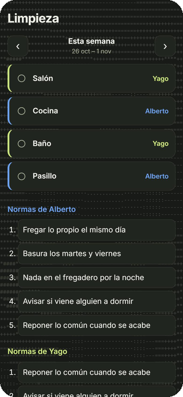

# limpiar

> A quién le toca limpiar qué, semana a semana.

Turnos de limpieza del piso para dos personas: cada semana rotan las zonas, cada uno marca lo
suyo y quedan a la vista las normas de la casa. Corre en una Raspberry Pi.



<sub>Captura con datos de ejemplo.</sub>

## Qué hace

- **Rotación semanal** de salón, cocina, baño y pasillo entre las dos personas, con navegación
  entre semanas.
- **Marcar lo hecho**: queda guardado por semana.
- **Normas de cada uno**, editables desde la página.
- **Faltas**: qué se quedó sin hacer, quién y por qué.

## Cómo está hecho

- FastAPI (`main.py`) con un `data.json`.
- Una página (`static/index.html`) sin compilar, con el estilo común «Calma» de mis apps.
- Sin contraseña propia: en producción va detrás de Cloudflare Access.

## Ponerlo en marcha

```bash
uv sync
uv run uvicorn main:app --port 8081
```

`LIMPIAR_DB` cambia la ruta del `data.json`. Pruebas: `uv run python test_limpiar.py`.
